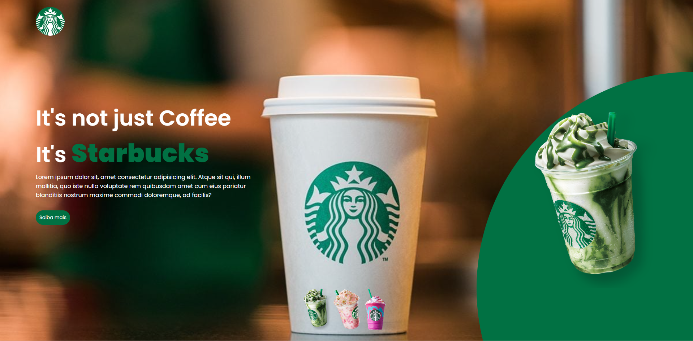

# ☕ Starbucks Landing Page

Uma landing page moderna e responsiva inspirada no Starbucks, desenvolvida com o objetivo de praticar e aperfeiçoar conceitos fundamentais de front-end.

---

### 🌐 Demonstração Online

Quer ver o projeto funcionando em tempo real? Acesse pelo link abaixo:

👉 **[Clique aqui para acessar o projeto online](https://lmvc007.github.io/projeto-starbucks/)**

---

### 📸 Preview do Projeto

<p align="center">
  
</p>

---

### 🛠️ Tecnologias Utilizadas

Este projeto foi construído utilizando as seguintes tecnologias:

- **HTML5:** Estruturação semântica da página.

- **CSS3:** Estilização, layout flexível e responsividade.

- **JavaScript:** Interatividade e dinamismo aos elementos.

---

### 💻 Como rodar o projeto localmente

Caso queira baixar e testar o código na sua máquina:

1. Clone o repositório:
```bash
git clone https://github.com/LMVC007/projeto-starbucks.git
